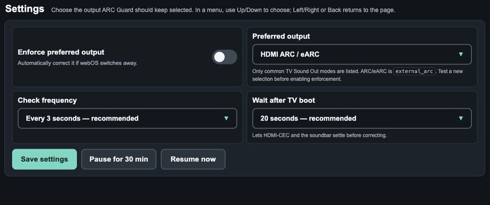

# ARC Guard

Keep your soundbar selected on a rooted LG webOS TV. ARC Guard restores HDMI ARC or eARC when the TV switches to another output.

## Features

- Restore your preferred Sound Out automatically.
- Test the selected output instantly and pause enforcement when you want TV speakers.
- Start monitoring at boot and see the latest correction in the app.

## Install

1. Open **Homebrew Channel → Settings → Add repository** and enter the [Homebrew catalog URL](https://raw.githubusercontent.com/vibribbonee/arcguard/main/repo.json), or download the [IPK from Releases](https://github.com/vibribbonee/arcguard/releases/latest).
2. Open ARC Guard, select **HDMI ARC / eARC**, and leave enforcement off while you test **Apply preferred output now** when the TV is on a different output. Enable enforcement once sound works.
3. Use **Service & Help** to install the boot hook if you want ARC Guard to start with the TV.

Version 1.0.9 was tested on LG UP78 (43UP78006LB), webOS 6.3.2-425. Sound Out options vary by model and firmware.

[Installation guide](docs/INSTALLATION.md) · [Architecture](docs/ARCHITECTURE.md) · [Sources and credits](docs/SOURCES_AND_CREDITS.md). Build with `./scripts/build.sh`.

## Contributing

Pull requests are welcome. Describe the change and how you tested it.

[MIT license](LICENSE). OpenAI Codex assisted with development, testing, and documentation.
